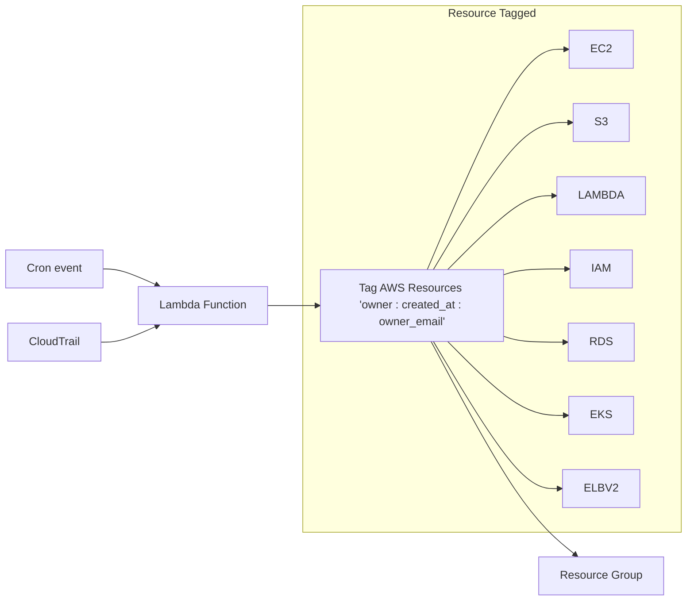

# AWS CloudTrail Resource Tagger

Automatically tags AWS resources based on CloudTrail events. When someone creates a resource in AWS, this tool automatically adds tags to identify the owner and creation time.

**What it does**
- Monitors CloudTrail events for resource creation
- Based on resource creation event it automatically tags those resources with owner, creation time and owner email
- Supports AWS services (EC2, S3, Lambda, RDS, EKS, SNS, SQS, ECS, Bedrock, Kafka/MSK, Kinesis, Batch, ElastiCache, MemoryDB, Auto Scaling etc.)
- Runs as a scheduled Lambda function
Of course. Here is the corrected text with suggestions for improvement.


**Benefits**

- **Cost Management**: Better cost allocation through consistent tagging.
- **Resource Cleanup Reminders**: Helps **set reminders** for removing unwanted **resources** created by users in a testing account.
- **Efficiency**: No manual tagging needed.

## Table of Contents

- [AWS CloudTrail Resource Tagger](#aws-cloudtrail-resource-tagger)
  - [Table of Contents](#table-of-contents)
  - [Architecture](#architecture)
  - [Getting started](#getting-started)
    - [Pre-required tools](#pre-required-tools)
    - [Install packages](#install-packages)
    - [Test locally](#test-locally)
    - [Deploy to AWS Lambda with scheduling](#deploy-to-aws-lambda-with-scheduling)
  - [Tags applied](#tags-applied)
  - [Supported AWS Services](#supported-aws-services)

## Architecture




## Getting started


### Pre-required tools
```
pip install uv pytest prek

npm install -g serverless
```

### Install packages
```
# Install project required python packages
uv sync

# start venv
poetry shell
# or
source .venv/bin/activte
```

### Test locally

```
export AWS_PROFILE=<your-profile>

python -m src.main
```

### Deploy to AWS Lambda with scheduling

```
# This will deploy the cloudformation stack and the source code via serverless through config `serverless.yml`
sls deploy
```

## Tags applied

| Tag | Value |
|---|---|
| `owner` | CloudTrail username of whoever created the resource |
| `created_at` | Event time, formatted `YYYY-MM-DD HH:MM:SS UTC` |
| `owner_email` | Email of the owner, or `Unknown` (see below) |

`owner_email` is resolved in this order:
1. `owner` already looks like an email address → used as is.
2. The IAM user named in `owner` has a tag `EMAIL_ID: <email>` → that value is used.
3. Otherwise (no tag, not an IAM user such as an assumed role or root, or the lookup fails) → `Unknown`.

To make emails resolvable for IAM users, tag them, e.g. `aws iam tag-user --user-name <name> --tags Key=EMAIL_ID,Value=<email>`. Only IAM users are looked up; assumed-role/SSO session names that aren't emails resolve to `Unknown`.

## Supported AWS Services

The AWS Tagger automatically tags resources from the following AWS services:

- **Compute**: EC2, Lambda, ECS, ECR, EKS, Auto Scaling, Batch
- **Storage/Database**: S3, EFS, RDS/Aurora, DynamoDB, Redshift, ElastiCache, MemoryDB
- **Streaming/Messaging**: Kinesis, Kafka (MSK), SNS, SQS
- **Networking**: VPC, ELB, CloudFront, Route53
- **Security**: IAM, KMS, Secrets Manager, Cognito
- **Monitoring**: CloudWatch Logs, CloudWatch Alarms
- **Development**: API Gateway, Step Functions, CloudFormation
- **Analytics**: Glue, OpenSearch, Bedrock
- **Mobile**: Amplify
