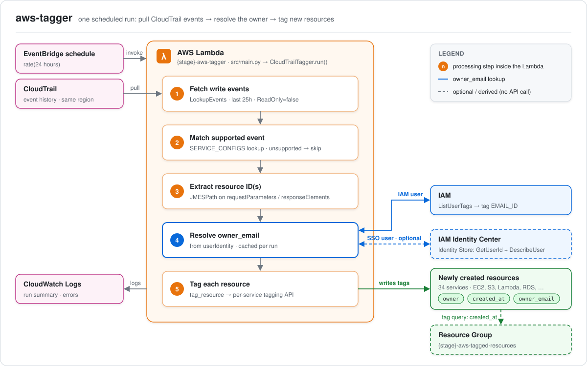
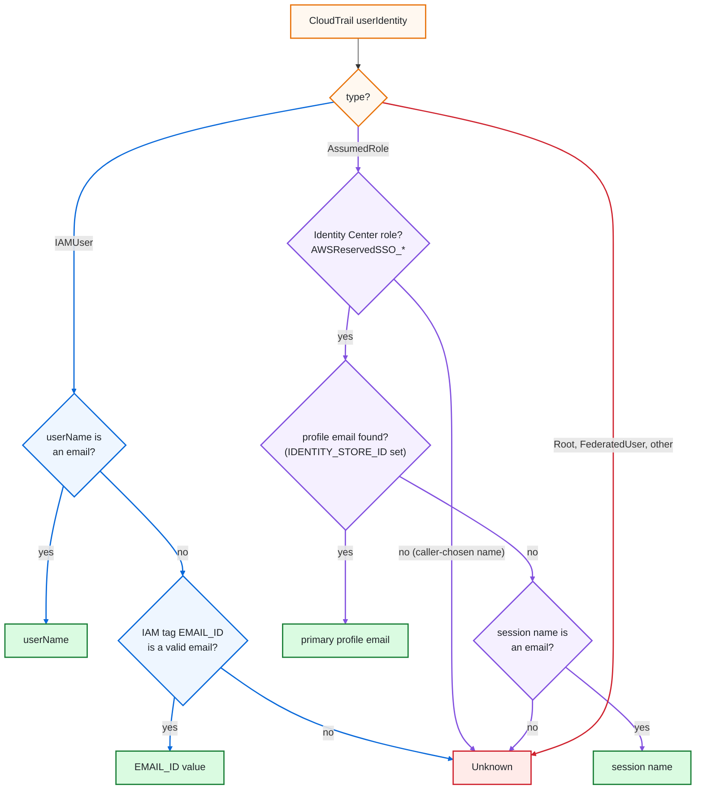

# AWS CloudTrail Resource Tagger

Automatically tags AWS resources based on CloudTrail events. When someone creates a resource in AWS, this tool automatically adds tags to identify the owner and creation time.

**What it does**
- Monitors CloudTrail events for resource creation
- Based on resource creation event it automatically tags those resources with owner, creation time and owner email
- Supports AWS services (EC2, S3, Lambda, RDS, EKS, SNS, SQS, ECS, Bedrock, Kafka/MSK, Kinesis, Batch, ElastiCache, MemoryDB, Auto Scaling etc.)
- Runs as a scheduled Lambda function

**Benefits**

- **Cost Management**: Better cost allocation through consistent tagging.
- **Resource Cleanup Reminders**: Helps **set reminders** for removing unwanted **resources** created by users in a testing account.
- **Efficiency**: No manual tagging needed.

## Table of Contents

- [AWS CloudTrail Resource Tagger](#aws-cloudtrail-resource-tagger)
  - [Table of Contents](#table-of-contents)
  - [Architecture](#architecture)
  - [Supported AWS Services](#supported-aws-services)
  - [Getting started](#getting-started)
    - [Pre-required tools](#pre-required-tools)
    - [Install packages](#install-packages)
    - [Test locally](#test-locally)
    - [Deploy to AWS Lambda with scheduling](#deploy-to-aws-lambda-with-scheduling)
  - [Tags applied](#tags-applied)

## Architecture



How a run works:

1. **Trigger**: EventBridge invokes the Lambda every 24 hours.
2. **Fetch**: the Lambda pulls the last **25h** of write (non read-only) management events from CloudTrail event history in its own region. No trail is needed. The extra hour overlaps the previous run, so events at the schedule boundary aren't missed. Re-tagging is idempotent.
3. **Match**: each event's `EventName` is looked up in `SERVICE_CONFIGS` (`src/services.py`). Unsupported events are skipped.
4. **Extract**: a JMESPath expression pulls the resource ID(s) out of `requestParameters` or `responseElements`. One event can create several resources (e.g. `RunInstances`).
5. **Resolve owner**: `owner` is the CloudTrail username. `owner_email` comes from the caller's `userIdentity`, via an IAM user tag or the Identity Center profile (see [Tags applied](#tags-applied)).
6. **Tag**: `tag_resource` calls the right tagging API for the service, because ARN vs. name vs. ID and the tag shape differ per service.
7. **Group**: the `<stage>-aws-tagged-resources` Resource Group (created by `serverless.yml`) shows every resource that has a `created_at` tag. The Lambda doesn't write to it.

## Supported AWS Services

The AWS Tagger automatically tags resources from the following AWS services:

- **Compute**: EC2, Lambda, ECS, ECR, EKS, Auto Scaling, Batch
- **Storage/Database**: S3, EFS, RDS/Aurora, DynamoDB, Redshift, ElastiCache, MemoryDB
- **Streaming/Messaging**: Kinesis, Kafka (MSK), SNS, SQS
- **Networking**: VPC, ELB, CloudFront, Route53
- **Security**: IAM, KMS, Secrets Manager, Cognito
- **Monitoring**: CloudWatch Logs, CloudWatch Alarms
- **Development**: API Gateway, Step Functions, CloudFormation
- **Analytics**: Glue, OpenSearch, Bedrock
- **Mobile**: Amplify

## Getting started


### Pre-required tools
```
pip install uv pytest prek

npm install -g serverless
```

### Install packages
```
# Install project required python packages
uv sync

# start venv
poetry shell
# or
source .venv/bin/activte
```

### Test locally

```
export AWS_PROFILE=<your-profile>

python -m src.main
```

### Deploy to AWS Lambda with scheduling

```
# This will deploy the cloudformation stack and the source code via serverless through config `serverless.yml`
sls deploy
```

## Tags applied

| Tag | Value |
|---|---|
| `owner` | CloudTrail username of whoever created the resource |
| `created_at` | Event time, formatted `YYYY-MM-DD HH:MM:SS UTC` |
| `owner_email` | Email of the owner, or `Unknown` (see below) |

`owner_email` is resolved for **IAM users** and **IAM Identity Center (SSO) users**:



*IAM user* (CloudTrail `userIdentity.type == IAMUser`), in this order:
1. The IAM user name looks like an email address → used as is.
2. The IAM user has a tag `EMAIL_ID: <email>` and the value is a valid email → that value is used.
3. Otherwise (no tag, invalid tag value, or the lookup fails) → `Unknown`.

*SSO user* (assumed role `AWSReservedSSO_*` under the Identity Center `aws-reserved/sso.amazonaws.com` role path; its session name is the Identity Center username, set by Identity Center, not the caller):
1. The user's Identity Store profile has a valid email → the primary email is used.
2. Otherwise (lookup not configured, user not found, or the call fails) → the session name if it looks like an email.
3. Otherwise → `Unknown`.

SSO support is optional and works for IAM-only, SSO-only, and mixed IAM + SSO accounts: each identity type resolves through its own path, and without `IDENTITY_STORE_ID` no Identity Store call is made.

To enable the profile lookup, deploy with the Identity Center directory ID (and its region, if it differs from the Lambda's):
```
export IDENTITY_STORE_ID=d-xxxxxxxxxx      # IAM Identity Center > Settings > Identity source
export IDENTITY_STORE_REGION=eu-west-1     # optional
sls deploy
```
The Identity Store API is only callable from the Identity Center management (or delegated admin) account, so run the tagger there for the lookup to work.

Other assumed-role, federated and root identities always resolve to `Unknown`: their CloudTrail name is a caller-chosen session name and can't be trusted.

To make emails resolvable for IAM users, tag them, e.g. `aws iam tag-user --user-name <name> --tags Key=EMAIL_ID,Value=<email>`. Restrict who may write `EMAIL_ID` (e.g. via an IAM policy/SCP on `aws:TagKeys`), since changing it redirects notifications.
